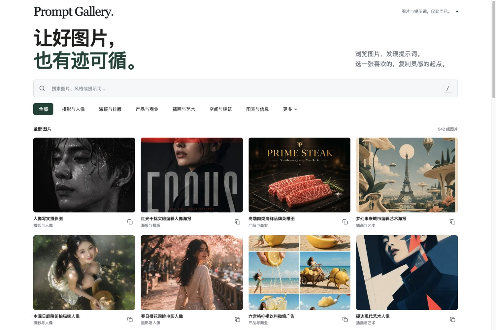

# Prompt Gallery

一个只专注图片和对应提示词的网站。浏览图片、按分类筛选、搜索、打开大图、复制完整提示词。

这是从 AI Visual Operating System 的素材中重新制作的独立项目，使用 React + Vite + TypeScript。运行时只读取本项目内的静态数据和图片，不依赖原项目，不需要数据库、账号或 API 密钥。

## 本地运行

需要 Node.js 22.12+。

```bash
npm ci
npm run dev
```

访问 http://127.0.0.1:3003 。开发服务默认绑定本机地址；如端口被占用，可使用 `npm run dev -- --port 4000`。



## 构建与验证

```bash
npm test
npm run build
npm run preview
```

`npm run build` 会检查每条提示词、图片、缩略图和来源地址，再执行 TypeScript 检查并构建。`dist/` 可以部署到任意静态网站托管服务，不需要服务端。

## 内容维护

- `src/data/prompts.json`：图片、提示词、分类、标签和原始来源。
- `public/images/`：本地图片及 WebP 缩略图。列表加载缩略图，详情加载完整图片；用户上传的图片保留原文件。
- 每条记录的 `id` 必须唯一；`images` 支持同一提示词的多张配图。
- 搜索匹配标题、分类、标签和完整提示词；关键词之间用空格表示同时匹配。
- 详情链接包含 `?prompt=ID`，可以直接打开或在浏览器中返回。

当前内容包含 547 条提示词、553 张图片。提示词原文保留；少量相近分类合并为更易浏览的分类。迁移图片作尺寸优化和 WebP 转换，后续用户上传图片保留原文件并另建缩略图。图片来源和提示词作者在每条详情中保留，相关说明见 [NOTICE.md](NOTICE.md)。

没有登录、账号、生成图片、模板库、工作流、历史记录、资产管理或案例库模块。
